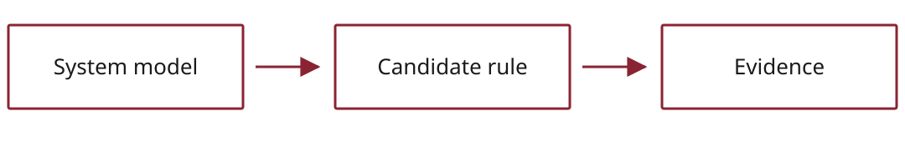

<!-- _class: title -->
<!-- _paginate: false -->
<!-- _header: "" -->
<!-- _footer: "" -->

<h1><span class="t1">{{title}}</span><br><span class="t2">{{subtitle}}</span></h1>
<div class="rule"></div>
<div class="authors">{{author}}</div>
<div class="meta">{{event}} · {{date}}</div>
<div class="lockup"></div>
<div class="presenter-card"><div class="who"><div class="name">{{author}}</div><div class="role">{{affiliation}}</div></div></div>

<!--
@00:00
SAY Introduce yourself, the problem, and the contribution in one sentence.
This deck uses a fictional job queue to demonstrate the template. Replace its
examples with evidence from your own project before presenting.
-> Show a concrete failure before introducing the method.
-->

---

<div class="rule-top"><span>Problem</span></div>

# A retry can repeat a completed job

<div class="cols">
<div class="card"><div class="label">Example scenario</div>
A worker completes a job, but its acknowledgement is lost. The queue sends the same job again.
</div>
<div class="card orange"><div class="label">Why it matters</div>
Running a payment or notification twice may change the result. The system needs an explicit rule for retries.
</div>
</div>

> What happens when the same request arrives twice?

<p class="note">Illustrative example only. This is not a claim about a particular platform.</p>

<!--
@00:30
>> Walk through the lost acknowledgement, then the retry.
ASK Which component can tell whether the first attempt completed?
-> Turn that failure into the research question.
-->

---

<div class="rule-top"><span>Question</span></div>

# State a question you can test

<p class="big">Under which assumptions can a retry leave<br>the completed job unchanged?</p>

<div class="cols">
<div class="card blue"><div class="label">Scope</div>One queue, one worker, and a stable identifier for each logical job.</div>
<div class="card"><div class="label">Evidence to collect</div>A model of failures, a candidate rule, and tests or proofs that challenge it.</div>
</div>

<!--
@01:30
SAY Replace this question with your research question and state its boundary.
-> Explain how your method connects the question to evidence.
-->

---

<!-- _class: red -->
<!-- _header: "" -->
<!-- _footer: "" -->
<!-- _paginate: false -->

<div class="num">01 / Method</div>

# Make the assumptions explicit

<div class="dash"></div>
<div class="thesis">Describe the system, propose a rule, then try to break it.</div>

<!--
@02:00
SAY Use a divider only when it helps the audience follow a change in topic.
-->

---

<div class="rule-top"><span>Method</span></div>

# Connect each step to an output



<div class="cols-3">
<div class="card"><div class="label">Model</div>State which messages can be lost and what storage survives.</div>
<div class="card"><div class="label">Rule</div>Record job completion together with its effect.</div>
<div class="card"><div class="label">Check</div>Explore a retry before, during, and after completion.</div>
</div>

<p class="caption">Each arrow should correspond to a step another researcher can reproduce.</p>

<!--
@02:20
>> Read the diagram from left to right. Point to the output of each step.
-> Show enough of the mechanism to explain why the check matters.
-->

---

<div class="rule-top"><span>Mechanism</span></div>

# A completion record is part of the rule

```text
within one atomic transaction:
    if job.id is already completed:
        return its stored result
    result = apply the job's effect
    record completion and result
```

<div class="card orange"><div class="label">Assumption</div>The effect and the completion record share a transaction. An external side effect needs a different protocol.</div>

<p class="note">Pseudocode for discussion, not a production implementation.</p>

<!--
@03:30
SAY Point out the atomicity assumption before claiming that retries are safe.
-> Show how you would test that assumption.
-->

---

<div class="rule-top"><span>Evaluation</span></div>

# Make the expected evidence visible

| Scenario | Question for the evaluation | Evidence to record |
| :--- | :--- | :--- |
| No retry | Does a job complete? | Result and completion record |
| Retry after completion | Is its effect repeated? | State before and after retry |
| Failure during commit | Are effect and record consistent? | Trace or counterexample |

<p class="caption">This is an evaluation plan. Replace it with measured results or proof outcomes and cite their source.</p>

<!--
@04:30
SAY No experiments are claimed here. Replace the plan with your actual results.
For quantitative results, show a plot with units, sample counts, and uncertainty.
-> Explain where the evidence stops.
-->

---

<div class="rule-top"><span>Limits</span></div>

# Say where the conclusion stops

- A stable identifier must refer to the same logical job.
- A database transaction does not automatically cover an external service.
- A successful test covers the tested execution; a proof depends on its model.

<div class="card"><div class="label">Next experiment</div>Introduce an external notification and inspect the gap between sending it and recording completion.</div>

<!--
@05:30
SAY Replace these with the assumptions and limitations of your own result.
-> Close with the answer to the question, at the strength your evidence supports.
-->

---

<!-- _class: closing -->
<!-- _header: "" -->
<!-- _footer: "" -->
<!-- _paginate: false -->

# Close with your supported conclusion

<p>State the answer, the evidence, and the main limitation.</p>
<div class="contact">{{author}}<small>{{affiliation}}</small><small><a href="{{projectUrl}}">{{projectUrl}}</a></small></div>
<div class="lockup"></div>

<!--
@06:00
SAY Replace the instruction on this slide with your actual take-home statement.
Leave a useful project link visible during questions. Add a QR code only after
checking its destination and testing it on a phone from the back of the room.
-->

---

<div class="rule-top"><span>Backup</span></div>

# Keep detailed evidence after the close

<div class="cols">
<div class="card"><div class="label">Reproducibility</div>Document the revision, configuration, commands, and input data needed to reproduce your result.</div>
<div class="card"><div class="label">Sources</div>Add verified references for borrowed ideas and figures. Link each reported result to its experiment or proof.</div>
</div>

<p class="note">Replace this slide with definitions, additional results, or references that support likely questions.</p>

<!--
Use backup slides in response to questions. They are outside the timed talk.
-->
