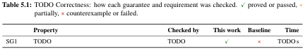
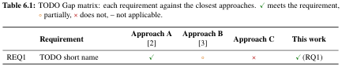

# Skim view: TODO Title of the paper

Paper `t3-3bd95abb`, built from `reviewer.tex`; 18 PDF pages; main text 8 pages (p. 1–8).

This is what a reviewer sees when skimming: headings, figures, tables, tagged items and coloured boxes verbatim; every paragraph only as `¶ N lines`, display math, listings and plain lists only as counts. `[cites: ...]` after a paragraph lists the tags it refers to (↗ = clickable link, plain = hand-typed). `[placeholder: ...]` marks a structure that shows template text, with the text it shows. Evidence is detected, placeholder, unsure (declared in the sources, not read from the PDF) or missing; detected says only that the structure is there, not that it is good.

## Summary

- PDF pages: 18
- main text pages: 8
- figures: 3
- tables: 2
- boxes: 8
- placeholders visible: 40 (8 boxes, 7 paragraphs, 7 tagged items, 5 figures and tables, 3 headings, 3 theorem-likes, 3 back-matter pages, 2 front-matter pages, 1 proof, 1 listing)
- TODO printed: 67
- tagged items: 7
- tagged items unsure: 0
- theorem-likes: 3
- paragraphs: 14
- footnotes: 0
- citation links: 3
- bibliography entries: 3

## Extraction notes

| detected in the PDF | count | declared in the included sources |
|---|---|---|
| figure | 3 | 3 |
| table | 2 | 2 |
| box | 8 | 8 |
| tag item | 7 | 7 |
| theorem-like | 3 | 3 |
| tag-list label in the .aux | 7 | 7 |

- lines not assigned to any block: 0
- margin-note lines ignored: 35

## Review criteria (scoring sheet)

From the guide (`guide/06-tdk-rules-and-dates.tex`, the review sheet section) and the sheet PDF (`TDK2025_biralati_pontozolap_hallgatoi.pdf`). Chapters carry criteria by their role, as the lint assigns them (`work/template-review/lint-plan.json`).

### A. Szerkesztés, stílus (0–5)

Top score, in the sheet's words: “4–5: kiváló (ha a dolgozat közel hibamentes, jól tagolt, követhető, gördülékeny stílusú)”. The sheet also says: “Terjedelmi korlát 30–35 oldal. Ettől eltérés esetén 3 oldalanként 1 pont levonás javasolt.” “Műszaki tudományi OTDK szekcióba 50 oldal felett nem fogadnak dolgozatot.” The sheet recommends that reviewers deduct the point; it does not require them to.

> Terjedelmi korlát 30-35 oldal. Ettől eltérés esetén 3 oldalanként 1 pont levonás javasolt. Műszaki tudományi
> OTDK szekcióba 50 oldal felett nem fogadnak dolgozatot.
- 0-1: gyenge (ha a dolgozat nehezen áttekinthető, gondatlanul szerkesztett, sok szerkesztési, nyelvtani hibával)
- 2: átlagos (ha a dolgozat gondosan szerkesztett, azonban a dolgozat lényegi mondanivalója több helyen nehezen áttekinthető, körülményes)
- 3: jó (ha a dolgozat gondosan szerkesztett, azonban a dolgozat szövegezése néhány helyen nehezen áttekinthető, körülményes);
- 4-5: kiváló (ha a dolgozat közel hibamentes, jól tagolt, követhető, gördülékeny stílusú)

Carried by: the whole paper

### B/1. Ábrák, táblázatok (0–4)

Top score, in the sheet's words: “4: kiváló (a dolgozat megfelelő számú és jól átgondolt ábrát, táblázatot tartalmaz, és a szakirodalmi hivatkozások pontosak)”.

- 0: nagyon gyenge (a dolgozat alig / egyáltalán nem tartalmaz magyarázó ábrákat ill. táblázatokat, pedig a téma feldolgozása igényelte volna)
- 1: gyenge (a dolgozat kevés ábrát ill. táblázatot tartalmaz, pedig a téma feldolgozása igényelte volna)
- 2: átlagos (a dolgozat megfelelő számú ábrát és táblázatot tartalmaz, ám azok több esetben nem jól átgondoltak vagy rossz minőségűek)
- 3: jó (a dolgozat megfelelő számú és jól átgondolt ábrát, táblázatot tartalmaz, ám a szakirodalmi hivatkozások számos helyen pontatlanok)
- 4: kiváló (a dolgozat megfelelő számú és jól átgondolt ábrát, táblázatot tartalmaz, és a szakirodalmi hivatkozások pontosak)

Carried by: 1 Introduction (intro)

### B/2. Hivatkozások, irodalom feldolgozás (0–4)

Top score, in the sheet's words: “3–4: újszerű ipari megoldások és kutatási eredmények (a dolgozat – az újszerű ipari megoldásokon túl – bemutatja a dolgozat témakörében releváns kutatási eredményeket a szakterületen)”. B is the average of B/1 and B/2.

> A B bírálati szempont pontszáma a részpontok átlagaként képzendő. Ha a B/1 szempont nem értelmezhető,
> akkora B bírálati szempont pontszáma a B/2.
- 0: egyetemi tananyag (a dolgozat kizárólag egyetemi tankönyveket idéz kapcsolódó szakirodalomként)
- 1: ismert ipari gyakorlat (a dolgozat feldolgozta a weblapokról, technikai dokumentációkból közismert ipari megoldásokat)
- 2: újszerű ipari megoldások vagy közismert kutatási eredmények (a dolgozat ismerteti a legújabb, modern ipari megoldásokat vagy a legismertebb kutatási eredményeket a szakterületen)
- 3-4: újszerű ipari megoldások és kutatási eredmények (a dolgozat – az újszerű ipari megoldásokon túl – bemutatja a ldolgozat témakörében releváns kutatási eredményeket a szakterületen)

Carried by: 2 Background (background); 6 Related Work and Gap Analysis (related)

### C. A dolgozat témája (0–8)

Top score, in the sheet's words: “7–8: tudományos vizsgálat szükséges (ha a dolgozat témája korszerű, nem lezárt, vizsgálata magas szintű, tudományos, elmélyült tudást igényel)”.

> Tématerület fontossága, aktualitása (Relevance)
- 0: elavult (ha a dolgozat témája elavult, korszerűtlen, szakirodalomban alaposan kidolgozott és vizsgálata nem igényel elmélyült tudást)
- 1-2: korszerű, de közismert (ha a dolgozat témája korszerű, de jól ismert, elmélyült tudást nem igényel a vizsgálata)
- 3-4: közismert, de mély (ha a dolgozat témája korszerű, de jól ismert, szakirodalomban / kézikönyvekben többé-kevésbé kidolgozott, azonban vizsgálata alapos, elmélyült tudást igényel)
- 5-6: mély és újszerű (ha a dolgozat témája korszerű, újszerű, vizsgálata egy újszerű ipari technológia / eszköz igen mély ismeretét igényli)
- 7-8: tudományos vizsgálat szükséges (ha a dolgozat témája korszerű, nem lezárt, vizsgálata magas szintű, tudományos, elmélyült tudást igényel).

Carried by: 1 Introduction (intro)

### D/1. Tudományos újdonságtartalom és kontribúció (0–5)

Top score, in the sheet's words: “5: újszerű (legalább hazánkban újszerű, vagy eddig még nem létező megoldás)”; one step below, “3–4: inkrementális (értékes inkrementális kontribúció, létező megoldások apró továbbfejlesztése)”.

- 0: közismert (a tárgyalt probléma megoldása egyetemi tankönyvekből ismert)
- 1-2: ismert (a kutatási terület szakirodalomban számos megoldás ismert a tárgyalt problémára, és ezek „másolás jellegű” alkalmazására került sor a dolgozatban)
- 3-4: inkrementális (értékes inkrementális kontribúció, létező megoldások apró továbbfejlesztése)
- 5: újszerű (legalább hazánkban újszerű, vagy eddig még nem létező megoldás)

Carried by: 3 Approach (approach); 4 Implementation (implementation); 6 Related Work and Gap Analysis (related)

### D/2. Technikai helyesség és színvonal (0–5)

Top score, in the sheet's words: “5: kiváló (kimagasló színvonalú kidolgozás, a közölt eredmények helyessége kétségkívül megalapozott)”. D is the sum of D/1 and D/2.

> A D bírálati szempont pontszáma a két alkategória összegeként alakítandó ki.
- 0: alacsony (ha a feldolgozás módszere kifogásolható, színvonala alacsony, a dolgozat alapvető szakmai hibákat tartalmaz)
- 1: kielégítő (ha a kidolgozás módszere és színvonala kielégítő, de a dolgozatban lényeges, tartalmi, szakmai hibák vannak)
- 2: kérdéses (színvonalas kidolgozás, de egyes részletekben kisebb szakmai hibák vannak, vagy egyes eredmények helyessége kérdéses / egyáltalán nem ellenőrizhető)
- 3-4: jó (színvonalas kidolgozás, de esetleg egyes eredmények helyessége nincs kellőképpen alátámasztva)
- 5: kiváló (kimagasló színvonalú kidolgozás, a közölt eredmények helyessége kétségkívül megalapozott)

Carried by: 3 Approach (approach); 4 Implementation (implementation); 5 Evaluation (evaluation)

### E. Bevezetés és az eredmények értékelése (0–8)

Top score, in the sheet's words: “7–8: teljeskörű – A bevezetés megfelelő és az elért eredmények pontosak és teljesek, az értékelés megalapozott. A szerző skálázhatósági, robosztussági vizsgálatokat is elvégzett, mellyel igazolta, hogy rendszere ipari környezetben is megállja a helyét”.

- 0: teljesen hiányzik – ha a dolgozat bevezetése hiányos (tématerület áttekintése, problémafelvetés, fő kontribúció kimondása) ÉS az eredmények gyakorlati validálása, értékelése is hiányzik ill. hibás;
- 1-2: nagyon hiányos – ha a dolgozat bevezetése hiányos (tématerület áttekintése, bemutatása, problémafelvetés, fő kontribúció kimondása) VAGY az eredmények értékelése hiányzik ill. aránytalanul kis méretű vagy hibás;
- 3-4: pontatlan – ha a dolgozat bevezetése megfelelő és a dolgozatban szerepel az eredmények kis mintapéldákon túlmenő értékelése is, de az utóbbi hiányos, pontatlan;
- 5-6: pontos, de hiányos – ha a dolgozat bevezetése megfelelő és a dolgozatban szerepel az eredmények kis mintapéldákon túlmenő értékelése is, azok pontosak, de hiányosak;
- 7-8: teljeskörű – A bevezetés megfelelő és az elért eredmények pontosak és teljesek, az értékelés megalapozott. A szerző skálázhatósági, robosztussági vizsgálatokat is elvégzett, mellyel igazolta, hogy rendszere ipari környezetben is megállja a helyét

Carried by: 1 Introduction (intro); 5 Evaluation (evaluation); 7 Conclusion and Future Work (conclusion)

The sheet also asks for a written review (Szöveges értékelés): Tartalmi összefoglaló; Kontribúció, Újszerűség; Erős pontok; Gyenge pontok; Részletes értékelés (a fenti pontszámok rövid indoklásával, ezek is bekerülnek a bírálati lapra); Kérdések.

## Rubric map: evidence in this skim

### A

- [detected] main text 8 pages (p. 1–8); the sheet: 30–35, 22 pages outside: about 7 point(s) off (1 per 3 pages)
- [detected] outline: 7 chapters, 19 sections, 0 subsections, 0 subsubsections, 12 run-in heads
- [detected] no stretch of plain text over 1 page without an anchor
- [placeholder] template text visible in 40 place(s); TODO printed 67×
- [detected] tag references clickable: 8 of 10

### B/1

- [placeholder] 3 figures, 2 tables in the main text; per chapter: 1: 1F/0T; 2: 0F/0T; 3: 1F/0T; 4: 0F/0T; 5: 0F/1T; 6: 1F/1T; 7: 0F/0T; template text in Figure 1.1, Figure 3.1, Figure 6.1, Table 5.1, Table 6.1
- [placeholder] leading figure: Figure 1.1; shows template text "TODO"
- [detected] 3 sources cited (3 citation links); bibliography 3 entries

### B/2

- [placeholder] related work: ch. 6 Related Work and Gap Analysis, 1 page, 8 text lines, 2 citation links; template text in 4 place(s)
- [placeholder] background: ch. 2 Background, 1 page, 7 text lines, 0 citation links; template text in 4 place(s)
- [placeholder] gap matrix: Table 6.1; shows template text "TODO"
- [detected] bibliography: 3 entries

### C (nothing detected without template text)

- [placeholder] abstract: 125 words; shows template text "TODO"
- [placeholder] introduction: ch. 1 Introduction, 1 page, 17 text lines, 0 citation links; template text in 5 place(s); sections —; run-in heads ['Context.', 'Problem.', 'Requirements.', 'Gap.', 'Contributions.', 'Structure.']
- [placeholder] research questions: RQ1; RQ1 shows template text "TODO"
- [placeholder] leading figure: Figure 1.1; shows template text "TODO"

### D/1 (nothing detected without template text)

- [placeholder] contributions: C1; C1 shows template text "TODO"
- [placeholder] gap matrix: Table 6.1; shows template text "TODO"

### D/2 (nothing detected without template text)

- [placeholder] guarantees: SG1; SG1 shows template text "TODO"
- [placeholder] assumptions: AS1; AS1 shows template text "TODO"
- [placeholder] adversaries: ADV1; ADV1 shows template text "TODO"
- [placeholder] theorem-like statements: 1 Definition, 1 Lemma, 1 Theorem; 1 proof; Definition 1, Lemma 1, Theorem 2 show template text "TODO"
- [placeholder] correctness table: Table 5.1, rows for 1 of 1 guarantees; shows template text "TODO"

### E

- [placeholder] contributions: C1; C1 shows template text "TODO"
- [placeholder] evaluation: ch. 5 Evaluation, 1 page, 12 text lines, 0 citation links; template text in 3 place(s)
- [detected] research questions mentioned in the evaluation or conclusion: 1 of 1
- [missing] no figure or table about scalability (by caption)
- [missing] no figure or table about robustness (by caption)
- [placeholder] limitations: LIM1; LIM1 shows template text "TODO"
- [detected] contributions restated in the conclusion: 1 of 1

## Outline

| | heading | page | pages | lines |
|---|---|---|---|---|
| kivonat |  Kivonat | i | 1 | 2 |
| abstract |  Abstract | ii | 1 | 9 |
| main | 1 Introduction | 1 | 1 | 17 |
| main | 2 Background | 2 | 1 | 7 |
| main | &nbsp;&nbsp;2.1 TODO First concept [placeholder] | 2 | 0.2 | 4 |
| main | &nbsp;&nbsp;2.2 TODO Second concept [placeholder] | 2 | 0.5 | 1 |
| main | 3 Approach | 3 | 2 | 22 |
| main | &nbsp;&nbsp;3.1 Overview | 3 | 0.3 | 4 |
| main | &nbsp;&nbsp;3.2 TODO Model or design [placeholder] | 3 | 0.1 | 1 |
| main | &nbsp;&nbsp;3.3 Threat model and guarantees | 3 | 1.4 | 15 |
| main | 4 Implementation | 5 | 1 | 9 |
| main | &nbsp;&nbsp;4.1 Overview | 5 | 0.2 | 5 |
| main | &nbsp;&nbsp;4.2 Design decisions | 5 | 0.1 | 1 |
| main | &nbsp;&nbsp;4.3 TODO The key technical contribution [placeholder] | 5 | 0.4 | 1 |
| main | 5 Evaluation | 6 | 1 | 12 |
| main | &nbsp;&nbsp;5.1 Research questions | 6 | 0.1 | 2 |
| main | &nbsp;&nbsp;5.2 Setup | 6 | 0.1 | 2 |
| main | &nbsp;&nbsp;5.3 Correctness (RQ1) | 6 | 0.3 | 3 |
| main | &nbsp;&nbsp;5.4 Scalability (RQ2) | 6 | 0.1 | 1 |
| main | &nbsp;&nbsp;5.5 Robustness analysis (RQ3) | 6 | 0.1 | 1 |
| main | &nbsp;&nbsp;5.6 Threats to validity | 6 | 0.1 | 1 |
| main | 6 Related Work and Gap Analysis | 7 | 1 | 8 |
| main | &nbsp;&nbsp;6.1 Comparison criteria | 7 | 0.1 | 1 |
| main | &nbsp;&nbsp;6.2 Existing approaches | 7 | 0.4 | 4 |
| main | &nbsp;&nbsp;6.3 Gap | 7 | 0.2 | 1 |
| main | 7 Conclusion and Future Work | 8 | 1 | 7 |
| main | &nbsp;&nbsp;7.1 Summary | 8 | 0.2 | 3 |
| main | &nbsp;&nbsp;7.2 Limitations and future work | 8 | 0.6 | 2 |
| back |  Acknowledgements | 9 | 1 | 0 |
| back |  Bibliography | 10 | 1 | 0 |
| back |  Hallgatói nyilatkozat generatív mesterséges intelligencia alkalmazásáról | 11 | 2 | 0 |
| appendix |  Appendix | 13 | 1 | 4 |
| appendix | &nbsp;&nbsp;A.1 Appendix title | 13 | 0.8 | 3 |

## The paper as skimmed

### Abstract

[1 Field, 1–2 sentences, for any computer scientist: TODO why this area matters.] [2 Background, 2–3 sentences, for readers in related fields: TODO what the specific setting is and what existing approaches do.] [3 Problem, 1 sentence: TODO the general problem this work addresses, often starting with “However”.] [4 Main result, 1 sentence: TODO “Here we show that …” or an equivalent; this is the contribution in one sentence.] [5 Comparison, 2–3 sentences: TODO what the result reveals compared with what was known before, with the headline numbers from the evaluation.] [6 Context, 1–2 sentences: TODO what the result means for the field more generally.] [7 Broader perspective, optional, 2–3 sentences, for any computer scientist: TODO where this leads, e.g. the most important future work.]

Kivonat (Hungarian abstract), 1 lines.

### 1 Introduction  (p. 1)

**Context.** ¶ 1 lines
**Problem.** ¶ 1 lines

> **[box] Running example, TODO name of the running example** (p. 1) [placeholder: "TODO"]
> TODO Two or three sentences: the actors, what they want to do, and what goes wrong today. Every chapter returns to this scenario, so choose one small enough to follow and rich enough to show every requirement.

**Requirements.** ¶ 1 lines

- **REQ1** **TODO Short name** (requirement, p. 1 {label `req:first`}; 1 linked / 0 plain references in) [placeholder: "TODO"]
  A property the running example needs, stated so it can be checked.
**Gap.** ¶ 1 lines

**Figure 1.1** (p. 1, referenced 1× linked, 0× plain) [placeholder: "TODO"]: TODO leading figure.

**Contributions.** ¶ 1 lines [cites: Figure 1.1↗] [placeholder: "TODO"]

- **C1** **TODO Short name** (contribution, p. 1 {label `c:method`}; nothing refers to it) [placeholder: "TODO"]
  A theoretical contribution: a model, formalisation, algorithm or protocol, with what it guarantees (Chapter 3).
**Structure.** ¶ 3 lines

### 2 Background  (p. 2)

#### 2.1 TODO First concept  (p. 2) [placeholder: "TODO"]

> **[box] Running example, TODO name of the running example: in terms of the first concept** (p. 2) [placeholder: "TODO"]
> TODO The scenario of Chapter 1 restated with this concept’s vocabulary.

- **Definition 1** **TODO** (definition, p. 2; nothing refers to it) [placeholder: "TODO"]
  TODO A precise definition the later chapters rely on.

#### 2.2 TODO Second concept  (p. 2) [placeholder: "TODO"]

### 3 Approach  (p. 3)

#### 3.1 Overview  (p. 3)

¶ 1 lines [cites: Figure 3.1↗] [placeholder: "TODO"]

> **[box] Running example, TODO name of the running example: through the approach** (p. 3) [placeholder: "TODO"]
> TODO The scenario step by step: which component handles which part of it, and what each produces.

**Figure 3.1** (p. 3, referenced 1× linked, 0× plain) [placeholder: "TODO"]: TODO architecture.

#### 3.2 TODO Model or design  (p. 3) [placeholder: "TODO"]

- **ADV1** **TODO Malicious participant** (adversary, p. 3 {label `thr:example`}; 3 linked / 0 plain references in) [placeholder: "TODO"]
  A participant who …

> **[box] Running example, TODO name of the running example: under attack** (p. 3) [placeholder: "TODO"]
> TODO How ADV1 plays out in the scenario, and which guarantee stops it.

**Attacks.** ¶ 1 lines
**Trust and cryptographic assumptions.** ¶ 1 lines

- **AS1** **TODO Unforgeable signatures** (assumption, p. 3 {label `asm:example`}; 2 linked / 0 plain references in) [placeholder: "TODO"]
  The underlying signature scheme is existentially unforgeable under chosen-message attack.
**Out of scope.** ¶ 1 lines
**Guarantees.** ¶ 1 lines

- **SG1** **TODO Short name** (guarantee, p. 4 {label `g:example`}; 2 linked / 0 plain references in) [cites: AS1↗, ADV1↗] [placeholder: "TODO"]
  Under AS1, against ADV1, no participant can …

- **Lemma 1** **TODO** (lemma, p. 4; 1 linked / 0 plain references in) [placeholder: "TODO"]
  TODO A helper statement.

- **Theorem 2** **TODO** (theorem, p. 4; nothing refers to it) [cites: SG1↗, ADV1↗] [placeholder: "TODO"]
  TODO The main result: SG1 holds against ADV1.
proof, 1 lines [cites: Lemma 1↗, AS1↗] [placeholder: "TODO"]

### 4 Implementation  (p. 5)

#### 4.1 Overview  (p. 5)

¶ 1 lines [placeholder: "TODO"]
listing, 1 lines [placeholder: "TODO"]

> **[box] Running example, TODO name of the running example: as input** (p. 5) [placeholder: "TODO"]
> TODO The scenario as the implementation sees it: a configuration file, a model, or a test case.

#### 4.2 Design decisions  (p. 5)

### 5 Evaluation  (p. 6)

#### 5.1 Research questions  (p. 6)

- **RQ1** **TODO Correctness** (research question, p. 6 {label `rq:correct`}; 0 linked / 1 plain references in) [placeholder: "TODO"]
  Does the approach handle the running example correctly?

#### 5.2 Setup  (p. 6)

**Artifact availability.** ¶ 1 lines

#### 5.3 Correctness (RQ1)  (p. 6)

> **[box] Running example, TODO name of the running example: solved** (p. 6) [placeholder: "TODO"]
> TODO The scenario with this work, against Chapter 1; every case is in Table 5.1.

**Table 5.1** (p. 6, referenced 1× linked, 0× plain) [placeholder: "TODO"]: TODO Correctness: how each guarantee and requirement was checked. ✓proved or passed, ∘ partially, × counterexample or failed.

#### 5.4 Scalability (RQ2)  (p. 6)

### 6 Related Work and Gap Analysis  (p. 7)

#### 6.1 Comparison criteria  (p. 7)

¶ 1 lines [cites: Figure 6.1↗, Table 6.1↗] [placeholder: "TODO"]

> **[box] Running example, TODO name of the running example: elsewhere** (p. 7) [placeholder: "TODO"]
> TODO How the closest approach would handle the scenario, and which requirement it fails on.

**Figure 6.1** (p. 7, referenced 1× linked, 0× plain) [placeholder: "TODO"]: TODO positioning figure.

**Table 6.1** (p. 7, referenced 1× linked, 0× plain) [placeholder: "TODO"]: TODO Gap matrix: each requirement against the closest approaches. ✓meets the requirement, ∘partially, × does not, – not applicable.

#### 6.3 Gap  (p. 7)

### 7 Conclusion and Future Work  (p. 8)

#### 7.1 Summary  (p. 8)

> **[box] Running example, TODO name of the running example: in retrospect** (p. 8) [placeholder: "TODO"]
> TODO One or two sentences closing the scenario opened in Chapter 1.

#### 7.2 Limitations and future work  (p. 8)

- **LIM1** **TODO Short name** (limitation, p. 8 {label `lim:example`}; nothing refers to it) [placeholder: "TODO"]
  The evaluation uses synthetic workloads only.

#### A.1 Appendix title  (p. 13)

#### A.1 Appendix title  (p. 13)

¶ 2 lines [placeholder: "TODO"]

### Back matter

- Acknowledgements: 1 page(s), p. 9
- Bibliography: 1 page(s), 3 entries, p. 10
- Hallgatói nyilatkozat generatív mesterséges intelligencia alkalmazásáról: 2 page(s), p. 11

## Walls of text

Per chapter, the longest stretch of plain paragraphs (and math, lists, listings) with no anchor: no heading, run-in head, figure, table, box, tagged item or theorem-like. Over 1 page is flagged.

| chapter | longest stretch | lines | pages | over 1 page |
|---|---|---|---|---|
| 1 Introduction | — | | |  |
| 2 Background | — | | |  |
| 3 Approach | p. 4–4 | 1 | 0.03 | 0 |
| 4 Implementation | p. 5–5 | 2 | 0.05 | 0 |
| 5 Evaluation | — | | |  |
| 6 Related Work and Gap Analysis | p. 7–7 | 1 | 0.02 | 0 |
| 7 Conclusion and Future Work | — | | |  |

## Argument chains

Correctness table: Table 5.1; gap matrix: Table 6.1. Edges: linked = clickable reference, plain text = hand-typed tag, MISSING = no mention.

**Guarantees → assumptions / adversaries cited → correctness row**

- SG1 TODO Short name: assumptions AS1 (linked); adversaries ADV1 (linked); correctness: row

**Requirements → gap-matrix row → evaluation**

- REQ1 TODO Short name: gap matrix row; evaluation MISSING

**Contributions → restated in the conclusion**

- C1 TODO Short name: by name (fuzzy)

**Research questions → mentioned in the evaluation or conclusion**

- RQ1 TODO Correctness: plain text

## Reference quality

| target kind | items | with \label | mentions | linked | plain text | linked elsewhere |
|---|---|---|---|---|---|---|
| contribution | 1 | 1 | 0 | 0 | 0 | 0 |
| research question | 1 | 1 | 2 | 0 | 1 | 1 |
| requirement | 1 | 1 | 1 | 1 | 0 | 0 |
| assumption | 1 | 1 | 2 | 2 | 0 | 0 |
| adversary | 1 | 1 | 3 | 3 | 0 | 0 |
| guarantee | 1 | 1 | 2 | 2 | 0 | 0 |
| limitation | 1 | 1 | 0 | 0 | 0 | 0 |
| theorem-like | 3 | 3 | 1 | 1 | 0 | 0 |
| figure | 3 | 3 | 3 | 3 | 0 | 0 |
| table | 2 | 2 | 2 | 2 | 0 | 0 |

Nothing links to: C1, Definition 1, Theorem 2, RQ1, LIM1

Nothing even mentions: C1, Definition 1, Theorem 2, LIM1

